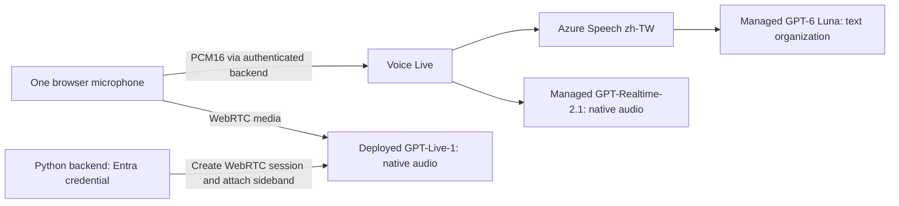

# Taiwanese-Mandarin recognition and telecom UAT portal

A standalone developer test portal extracted from an internal voice-portal prototype.
It contains **only recognition comparison and telecom UAT**: no airline service,
conversation studio, business tools, customer database, or customer-derived logs.
See `SOURCE-PROVENANCE.json` for source hashes and exclusions. Application examples
use generic codes and unbranded service/payment channels. Owner-specific source
repository references are omitted; required Microsoft/Azure/OpenAI product names
remain so the setup instructions are accurate.

This neutralization applies to the current source and generated pages. Earlier
Git commits retain their original examples; history has not been rewritten.
GitHub account ownership and commit-author metadata are separate from application
content. User-entered notes and exported results are not automatically
anonymized: use synthetic test inputs only.

## What you can test

- `/recognition`: one microphone, three real routes, editable per-route instructions,
  letter/number extraction defaults, independent error states, no generated-audio playback.
- `/recognition/uat`: 56 synthetic Taiwanese-Mandarin cases covering yes/no,
  birthdays, digits, all twelve zodiac animals, billing, renewal and payment channels.
  Prompts use the **question and field rules**, never the suggested utterance or expected answer.
- Explicit manual grading, prompt fingerprints, optional text retention, JSON import/export,
  and a downloadable HTML workbench that supports offline questions and saved records.
- Shared developer login, same-origin WebSocket admission, bounded sessions/queues,
  strict provider configuration checking, and no hidden replacement model.



**Native listening is not independent ASR evidence.** Realtime returns `heard_text`
and `formatted_text` in one model response. GPT-Live supplies native timed input/output
fragments, not authoritative completed turns. Only the Speech route sends a separate
recognizer's final text to Luna. Model text is not ground truth or identity verification.

## Required Azure resources

| Requirement | What to provision |
|---|---|
| Voice Live | A Microsoft Foundry **resource** (`AIServices`, S0) in a region supporting the selected models and API. East US 2 was used for the source implementation. |
| Speech + Luna route | Voice Live's managed `gpt-6-luna` plus its integrated `azure-speech` transcription with `zh-TW`. **No separate Luna deployment or Speech resource is needed for this implementation.** |
| Native Realtime route | Voice Live's managed `gpt-realtime-2.1`. **No separate Azure OpenAI Realtime deployment is needed for this implementation.** |
| Native GPT-Live route | An accessible **`gpt-live-1` model deployment**, its deployment name and the resource's `https://<name>.openai.azure.com` root. This can be the same Foundry resource or another one. |
| Runtime identity | Your signed-in Azure CLI identity locally; a managed identity when hosted. Grant the appropriate data-plane roles on every resource used. |
| Hosting, only if sharing a running URL | HTTPS/WebSocket-capable hosting. Included Bicep uses Azure Container Apps, a managed environment, ACR and a user-assigned managed identity. |

**Not required:** `gpt-live-transcribe`, a deployed Foundry Agent, a Foundry project
endpoint, Responses delegation, Azure Tables/SQL/Cosmos DB, MCP, custom speech,
separate TTS, or the source application's airline resources.

Read [Foundry setup and permissions](docs/foundry-setup.md) before provisioning.
Availability, access approval, quota and region support must be checked in the
developer's own subscription; this repository cannot grant model access.

## Quick start on Windows

Use Python **3.12**, Azure CLI, Git and a current Chrome/Edge browser. In PowerShell,
from the repository root:

```powershell
python -m venv .venv
.\.venv\Scripts\python.exe -m pip install -r requirements.txt
az login
az account set --subscription '<your-subscription-id>'
.\.venv\Scripts\python.exe tools\run_local.py `
  --subscription '<your-subscription-id>' `
  --voice-live-endpoint 'https://<your-foundry-resource>.services.ai.azure.com' `
  --gpt-live-endpoint 'https://<your-gpt-live-resource>.openai.azure.com' `
  --gpt-live-deployment 'gpt-live-1' `
  --username developer
```

Choose a new test-portal password when prompted. The launcher keeps its hash and
fresh session secret in process memory, binds to **127.0.0.1 only**, and explicitly
uses Azure CLI authentication for the requested subscription.

Open **http://localhost:8000/recognition/uat**, not a LAN IP. Sign in, select a case,
click **啟用既有三模型功能**, tick consent, click **開始同題比較**, allow the microphone,
wait for listening readiness, speak and pause about two seconds. End the recording
before changing cases or instructions. Grade what was actually spoken, not a
different suggested utterance.

`localhost` is a browser secure-context exception. A shared/LAN/public URL needs
**HTTPS** for the microphone and Secure session cookie. Do not expose the local
launcher publicly or enable `ALLOW_INSECURE_LOCALHOST` in hosting.

On macOS/Linux, use `python3`, `.venv/bin/python`, and ordinary shell line
continuation instead of the PowerShell examples. All Python paths are portable.

## Hosted deployment

See [Azure Container Apps deployment](docs/azure-hosting.md). It documents resource
creation, a private registry image, secure login parameters, identity/role assignment,
and readiness checks. `infra/foundry.bicep` creates a **new dev resource only**;
`infra/hosting.bicep` hosts the application against **existing** qualified endpoints.
Neither template silently deploys models, requests quota, or modifies an existing
resource's networking. Review infrastructure changes before running them.

The shared password is a demonstration access gate, **not production authentication**.
For production, add real Entra authentication/authorization, centralized rate limits,
appropriate network isolation, credential lifecycle controls and retention policies.

## Configuration

The application reads process environment, not `.env` automatically. `.env.example`
is a reference, not a usable credential file.

| Variable | Meaning |
|---|---|
| `VOICE_LIVE_ENDPOINT` | Foundry resource HTTPS root, `.services.ai.azure.com` or `.cognitiveservices.azure.com`; no project/API path. |
| `GPT_LIVE_ENDPOINT` | GPT-Live resource `.openai.azure.com` HTTPS root. |
| `GPT_LIVE_DEPLOYMENT` | Your actual GPT-Live deployment name; default `gpt-live-1`. |
| `AZURE_AUTH_MODE` | `cli`, `managed_identity`, or `default` (`DefaultAzureCredential`). |
| `AZURE_SUBSCRIPTION_ID` | Required for `cli` mode to select the intended subscription explicitly. |
| `AZURE_CLIENT_ID` | Client ID for a hosted user-assigned managed identity. |
| `PORTAL_USERNAME` | New developer-login username, not your Microsoft account password. |
| `PORTAL_PASSWORD_HASH` | PBKDF2-SHA256 hash generated by the included credential tool. |
| `PORTAL_SESSION_SECRET` | New random signing secret, at least 32 characters. |
| `APP_VERSION` | Asset cache-busting version. Increment when deploying frontend changes. |
| `ALLOW_INSECURE_LOCALHOST` | Default `false`; loopback development only. |

Missing endpoints are visibly unavailable, never substituted. Missing portal
credentials leave protected routes closed with HTTP 503. `/health` confirms the
process is alive, **not** that model access, WebRTC or inference has succeeded.

The qualified model/API contract is in `config/recognition.json`: Voice Live API
`2026-07-15`, managed `gpt-6-luna` and `gpt-realtime-2.1`. Unsupported combinations
fail explicitly. Porting to another model/API requires protocol and audio qualification,
not merely changing a dropdown label.

## Prompts and test-bank maintenance

UAT native Realtime prompt revision **`2026-11-04.2`** retains the recognition guidance
and uses neutral question-bank wording:

- Taiwanese-Mandarin short-answer context, with Traditional-Chinese text.
- All legal candidates from the selected question's rules, not a preferred answer.
- No forced conversion of clear English, unrelated speech or ambiguous sounds into a valid answer.
- One `report_recognition` call with two outer **strings**; `formatted_text` holds serialized
  `{status,value}` JSON. No recognizable speech means both strings are empty.
- No invented missing digits, database answers or execution of spoken instructions.

Edit `static/uat-app.js` for UAT prompt logic and `config/telecom_uat_cases.json` for
the bank, then regenerate the checked-in portable HTML:

```powershell
.\.venv\Scripts\python.exe tools\build_uat.py
```

`static/uat-template.html` and `static/uat-workbench.html` are its other source files.
The normal recognition page retains its separate code-extraction defaults in
`recognition_compare.py`. Reload after an update and start a new session; an active
recording's instruction draft is not silently replaced.

VAD remains unchanged: the Speech route uses multilingual Azure semantic VAD;
Realtime uses server VAD (`0.5` threshold, 300 ms prefix); both use 1,600 ms ending
silence and application-controlled responses. GPT-Live has its own native session
API. The prompt textbox does not configure VAD.

## Checks

No Azure credentials or model calls are needed for the deterministic checks:

```powershell
.\.venv\Scripts\python.exe -m pip install -r requirements-dev.txt
.\.venv\Scripts\python.exe -m unittest discover -s tests -v
```

Optional Chromium checks cover the hosted/offline workbench and prompt/export behavior:

```powershell
.\.venv\Scripts\python.exe -m playwright install chromium
$env:RUN_PORTAL_BROWSER_TESTS='1'
.\.venv\Scripts\python.exe -m unittest discover -s tests -v
```

These are not a recognition-accuracy benchmark. After setup, perform an explicit
real-microphone smoke on all three lanes, then a balanced UAT including every zodiac
animal, negative/ambiguous inputs, silence, leading zeros and paused dates. A
synthetic successful case does not prove human-accent accuracy.

## Privacy, measurements and troubleshooting

No server-side audio/transcript database exists. The browser only saves a UAT run
when the tester explicitly saves it; text retention is separately opt-in. JSON/HTML
exports may contain notes and opted-in synthetic text. Notes are not automatically
redacted. Browser storage is bounded to 100 runs; export before deleting records.

The portable HTML includes its saved records and works offline, but disables live
audio under `file://`. Its hosted link returns to the site from which it was exported.
It does not contain Azure credentials or become an independent cloud service.

| Symptom | Check |
|---|---|
| Audio controls disabled in a downloaded HTML | Intentional offline mode. Use the protected hosted page or configured localhost. |
| HTTP 503 on login | Missing/partial portal credentials; use the local launcher or configure all three secret values. |
| Lane is unavailable | Missing endpoint. The portal does not replace unavailable providers. |
| Lane fails at startup | Resource/model/API access, deployment name, Entra roles, quota, network reachability; inspect sanitized server error codes. |
| GPT-Live does not reach listening | Browser/firewall WebRTC connectivity, microphone permission, deployment and sideband access. |
| Remote HTTP microphone/login fails | Use HTTPS. Never weaken browser security or enable public insecure-cookie mode. |
| Dates split across rows | VAD segmentation. Do not mix fragments from different questions or call a late result a wrong answer. |
| “Heard” text and processed value agree but are wrong | Neither is ground truth; compare with the actual audio and human reference. |

The displayed first-result interval begins at listening readiness and includes
speaking/pauses; it is **not ASR latency**. Rows across providers are not aligned
semantic turns. This browser lab does not reproduce 8-kHz telephony, DTMF, TTS
echo/barge-in, identity verification or transfer behavior.
