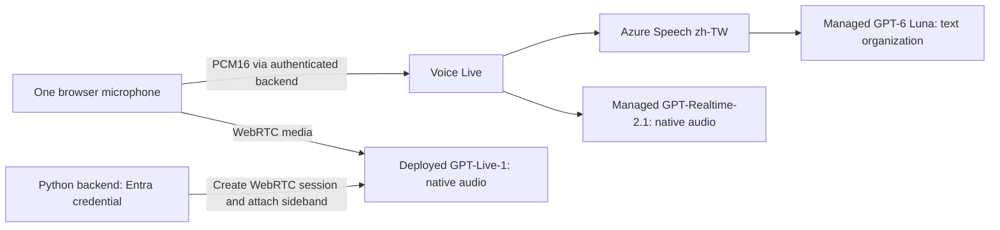

# Taiwanese-Mandarin recognition and telecom UAT portal

A standalone developer test portal extracted from an internal voice-portal prototype.
It contains **only recognition comparison and telecom UAT**: no airline service,
conversation studio, business tools, customer database, or customer-derived logs.
See `SOURCE-PROVENANCE.json` for source hashes and exclusions. Application examples
use generic codes and unbranded service/payment channels. Owner-specific source
repository references are omitted; required Microsoft/Azure/OpenAI product names
remain so the setup instructions are accurate.

This neutralization applies to the current source and generated pages. Earlier
Git commits retain their original examples; history has not been rewritten.
GitHub account ownership and commit-author metadata are separate from application
content. User-entered notes and exported results are not automatically
anonymized: use synthetic test inputs only.

## Start here

| Your goal | Follow this path | Where the portal password comes from |
|---|---|---|
| Test an existing hosted portal | Get its HTTPS URL and shared login from its maintainer; no clone or Azure CLI is needed just to use the browser UI. | The maintainer supplies it through an approved private channel. |
| Run your own local portal | [Get the source and tools](#get-the-source-and-tools), complete [Foundry prerequisites](#required-azure-resources), then [run locally](#quick-start-on-windows). | You choose it at the launcher's two password prompts. |
| Deploy your own Azure portal | [Get the source and tools](#get-the-source-and-tools), complete [Foundry prerequisites](#required-azure-resources), then [deploy to Azure](#deploy-to-azure-container-apps). | You choose it with `tools\make_credentials.py` before deployment. |

**There is no default passcode, OTP, registration flow or password-retrieval API.**
The default example username is `developer`, but the password is always chosen by
the person running or deploying the app. It is not your Azure password, an API key
or the session-signing secret. See [signing in and passwords](#signing-in-and-passwords).

## What you can test

- `/recognition`: one microphone, three real routes, editable per-route instructions,
  letter/number extraction defaults, independent error states, no generated-audio playback.
- `/recognition/uat`: 56 synthetic Taiwanese-Mandarin cases covering yes/no,
  birthdays, digits, all twelve zodiac animals, billing, renewal and payment channels.
  Prompts use the **question and field rules**, never the suggested utterance or expected answer.
- Explicit manual grading, prompt fingerprints, optional text retention, JSON import/export,
  and a downloadable HTML workbench that supports offline questions and saved records.
- Shared developer login, same-origin WebSocket admission, bounded sessions/queues,
  strict provider configuration checking, and no hidden replacement model.



**Native listening is not independent ASR evidence.** Realtime returns `heard_text`
and `formatted_text` in one model response. GPT-Live supplies native timed input/output
fragments, not authoritative completed turns. Only the Speech route sends a separate
recognizer's final text to Luna. Model text is not ground truth or identity verification.

## Required Azure resources

| Requirement | What to provision |
|---|---|
| Voice Live | A Microsoft Foundry **resource** (`AIServices`, S0) in a region supporting the selected models and API. East US 2 was used for the source implementation. |
| Speech + Luna route | Voice Live's managed `gpt-6-luna` plus its integrated `azure-speech` transcription with `zh-TW`. **No separate Luna deployment or Speech resource is needed for this implementation.** |
| Native Realtime route | Voice Live's managed `gpt-realtime-2.1`. **No separate Azure OpenAI Realtime deployment is needed for this implementation.** |
| Native GPT-Live route | An accessible **`gpt-live-1` model deployment**, its deployment name and the resource's `https://<name>.openai.azure.com` root. This can be the same Foundry resource or another one. |
| Runtime identity | Your signed-in Azure CLI identity locally; a managed identity when hosted. Grant the appropriate data-plane roles on every resource used. |
| Hosting, only if sharing a running URL | HTTPS/WebSocket-capable hosting. Included Bicep uses Azure Container Apps, a managed environment, ACR and a user-assigned managed identity. |

**Not required:** `gpt-live-transcribe`, a deployed Foundry Agent, a Foundry project
endpoint, Responses delegation, Azure Tables/SQL/Cosmos DB, MCP, custom speech,
separate TTS, or the source application's airline resources.

Read [Foundry setup and permissions](docs/foundry-setup.md) before provisioning.
Availability, access approval, quota and region support must be checked in the
developer's own subscription; this repository cannot grant model access.

Before proceeding, record the Voice Live resource endpoint, the GPT-Live endpoint
and deployment name, and the full Azure resource ID/subscription for each resource.
An administrator must grant the runtime identity inference permissions. If you
cannot create resources or assign roles, have the appropriate administrator
complete those steps rather than expecting `az login` to grant access.

## Get the source and tools

Install [Python 3.12](https://www.python.org/downloads/),
[Git](https://git-scm.com/downloads),
[Azure CLI](https://learn.microsoft.com/en-us/cli/azure/install-azure-cli) and a
current Chrome/Edge browser. Examples below use Windows PowerShell. Use this
repository's **Code -> clone URL**; the owner must grant access if it is private.
GitHub repository access and Azure access are separate.

Replace every `<...>` placeholder, including the angle brackets. Run from a
directory where you want the new checkout:

```powershell
git clone '<repository-clone-url>' voice-recognition-uat-portal
Set-Location voice-recognition-uat-portal
python --version
python -m venv .venv
.\.venv\Scripts\python.exe -m pip install -r requirements.txt

$subscription = '<your-subscription-id>'
az login
az account set --subscription $subscription
az account show --subscription $subscription --query '{subscription:id,identityType:user.type}' -o json
```

Confirm Python reports **3.12** and each command succeeds. For resources in another
Entra tenant, use `az login --tenant '<resource-tenant-id>'`. Keep this PowerShell
window open: later examples reuse `$subscription`. If you open a new window, set
the variables again. You do not need to activate the virtual environment because
the commands explicitly use its Python executable.

On macOS/Linux, use `python3`, `.venv/bin/python`, and ordinary shell line
continuation instead of the PowerShell examples. All Python paths are portable.

## Quick start on Windows

Complete the source/tool setup and Foundry prerequisites above. Your **CLI user's**
inference permissions must be granted on the configured resource(s); permission
given to an Azure-hosted app's managed identity does not authorize your user.
The [Foundry guide](docs/foundry-setup.md#4-authorize-the-runtime-identity) includes
the roles and assignment commands.

From the repository root:

```powershell
.\.venv\Scripts\python.exe tools\run_local.py `
  --subscription $subscription `
  --voice-live-endpoint 'https://<your-foundry-resource>.services.ai.azure.com' `
  --gpt-live-endpoint 'https://<your-gpt-live-resource>.openai.azure.com' `
  --gpt-live-deployment '<your-actual-gpt-live-deployment-name>' `
  --username developer
```

At **New portal password (12-256 characters)**, choose your own new password,
then enter the same value at **Confirm portal password**. Typing is hidden.
Save it in an approved password manager; the launcher does not print it, save it
to a file or generate an `access.json`. Keep the terminal/server running.

Open **http://localhost:8000/recognition/uat**, not a LAN IP. Sign in with username
**`developer`** and **the password you just typed**. Follow [your first microphone
test](#your-first-microphone-test). `/recognition` is the general letter/number
comparison page. If port 8000 is occupied, add `--port 8001` to the launch command
and use that port in the URL. Stop the server with **Ctrl+C**; restart the same
command to choose a new password if needed.

The launcher keeps the password hash and a fresh session secret in process memory,
binds to **127.0.0.1 only**, and explicitly uses Azure CLI authentication for the
requested subscription.

`localhost` is a browser secure-context exception. A shared/LAN/public URL needs
**HTTPS** for the microphone and Secure session cookie. Do not expose the local
launcher publicly or enable `ALLOW_INSECURE_LOCALHOST` in hosting.

**Two different sign-ins:** `az login` authenticates your developer account to
Azure. The username/password chosen by the launcher only protect the local portal;
they do not authorize Foundry access. The launcher explicitly selects
`AzureCliCredential` for `--subscription`, not the hosted app's managed identity.
Your developer account needs its own inference permissions on the configured
resource(s). No Azure API key, app registration or client secret is needed for this
local path. See [local authentication](docs/foundry-setup.md#local-development-azure-cli-identity).

Running locally provisions no Azure hosting resources, but inference still runs
on the configured Azure services and incurs their normal usage charges. A working
local test does not mean the models run offline.

## Deploy to Azure Container Apps

This is an alternative to running locally; **you do not need to start the local
server first**. Complete the source/tool setup above. Your deployment operator
needs permission to create hosting resources and assign ACR/AI roles. Contributor
alone does not grant role-assignment permission. Review the templates and charges
with your administrator before provisioning.

The following is the complete default path for a **new** registry, environment,
app and managed identity against **already qualified Foundry endpoints**. It does
not deploy models or request access/quota. To create a new Foundry resource first,
follow [Foundry setup](docs/foundry-setup.md); GPT-Live deployment/access is still
a separate prerequisite. For existing hosting resources, cross-subscription AI
roles, private-network requirements and password rotation, see the
[detailed hosting guide](docs/azure-hosting.md).

### 1. Prepare Azure CLI and hosting variables

Run each command successfully before continuing. Provider registration can take
several minutes and requires subscription permission.

```powershell
az extension add --name containerapp --upgrade
az bicep install
az provider register --subscription $subscription --namespace Microsoft.App --wait
az provider register --subscription $subscription --namespace Microsoft.OperationalInsights --wait
az provider register --subscription $subscription --namespace Microsoft.ContainerRegistry --wait
az provider register --subscription $subscription --namespace Microsoft.ManagedIdentity --wait

$location = 'eastus2'
$group = '<new-hosting-resource-group>'
$registry = '<globally-unique-lowercase-alphanumeric-acr-name>'
$app = '<new-container-app-name>'
$voiceEndpoint = 'https://<your-foundry-resource>.services.ai.azure.com'
$liveEndpoint = 'https://<your-gpt-live-resource>.openai.azure.com'
$liveDeployment = '<your-actual-gpt-live-deployment-name>'
$version = 'recognition-uat-20261104-r2'
$credentialsFile = '.local\credentials.parameters.json'
```

Use approved, unused names, not an existing production app. ACR names are 5-50
alphanumeric characters; app names must be lowercase, start with a letter, contain
only letters/digits/single hyphens, end with a letter/digit, and be shorter than
32 characters.

### 2. Create the registry and build the image

```powershell
az group create --subscription $subscription --name $group --location $location -o none
az acr create --subscription $subscription --resource-group $group --name $registry `
  --location $location --sku Basic -o none
az acr config authentication-as-arm show --subscription $subscription --registry $registry
```

The registry must allow ARM-audience tokens for managed-identity image pulls.
If the preceding command reports `disabled`, obtain approval and run
`az acr config authentication-as-arm update --subscription $subscription --registry $registry --status enabled`.
Do not change an existing registry's policy without approval. Use ordinary ACR
RBAC mode; this template grants `AcrPull`, not ABAC repository permissions.

```powershell
az acr build --subscription $subscription --registry $registry `
  --image "recognition-uat:$version" --file Dockerfile .
if ($LASTEXITCODE -ne 0) { throw 'Image build failed; stop before deployment.' }
$server = az acr show --subscription $subscription --name $registry --query loginServer -o tsv
$digest = az acr repository show --subscription $subscription --name $registry `
  --image "recognition-uat:$version" --query digest -o tsv
if ($LASTEXITCODE -ne 0 -or -not $digest) { throw 'Cannot resolve the built image digest.' }
$image = "$server/recognition-uat@$digest"
```

ACR builds the Dockerfile remotely; Docker Desktop is not required for this path.
The image is pinned by digest rather than a mutable tag.

### 3. Choose and save your portal login

```powershell
.\.venv\Scripts\python.exe tools\make_credentials.py --username developer --out $credentialsFile
if ($LASTEXITCODE -ne 0) { throw 'Credential generation failed; stop before deployment.' }
```

**You choose the password at the two hidden prompts.** Use 12-256 characters and
save it in an approved password manager. After deployment, log in as **`developer`
with that same chosen password**. There is no password generated by Azure to
retrieve afterward.

The ignored file `.local\credentials.parameters.json` contains the username,
password **hash** and session-signing secret, **not the original password**.
Restrict its filesystem access to your account and never commit or share it.
The tool refuses to overwrite an existing file; for a different deployment or
rotation, choose a new filename under `.local` and set `$credentialsFile` to it.

### 4. Deploy the application

```powershell
az deployment group create --subscription $subscription --resource-group $group `
  --name recognition-uat-hosting --template-file infra\hosting.bicep `
  --parameters "@$credentialsFile" `
  --parameters appName=$app registryName=$registry containerImage=$image location=$location `
    voiceLiveEndpoint=$voiceEndpoint gptLiveEndpoint=$liveEndpoint `
    gptLiveDeployment=$liveDeployment appVersion=$version -o none
if ($LASTEXITCODE -ne 0) { throw 'Hosting deployment failed; inspect the deployment before continuing.' }

$principal = az deployment group show --subscription $subscription --resource-group $group `
  --name recognition-uat-hosting --query properties.outputs.principalId.value -o tsv
$url = az deployment group show --subscription $subscription --resource-group $group `
  --name recognition-uat-hosting --query properties.outputs.url.value -o tsv
```

This creates an HTTPS-only Container App, its user-assigned managed identity,
an `AcrPull` assignment and a managed environment. It stores login values as app
secrets. It does **not** grant the identity Foundry inference access: do the next
step before testing audio. See the [hosting guide](docs/azure-hosting.md) if initial
image pull is delayed by role propagation.

### 5. Grant the application's identity inference access

Run these commands as an administrator allowed to assign roles at the AI resource
scope. `$principal` is the new **app identity**, not the deployer's user.
Use the actual full resource IDs recorded during Foundry setup:

```powershell
$voiceSubscription = $subscription
$liveSubscription = $subscription
$voiceResourceId = '<full-Voice-Live-Foundry-resource-id>'
$liveResourceId = '<full-GPT-Live-Foundry-resource-id>'

az role assignment create --subscription $voiceSubscription --assignee-object-id $principal `
  --assignee-principal-type ServicePrincipal --scope $voiceResourceId `
  --role 'f2dc8367-1007-4938-bd23-fe263f013447' -o none
az role assignment create --subscription $liveSubscription --assignee-object-id $principal `
  --assignee-principal-type ServicePrincipal --scope $liveResourceId `
  --role '5e0bd9bd-7b93-4f28-af87-19fc36ad61bd' -o none
```

These are **Cognitive Services Speech User** and **Cognitive Services OpenAI User**.
If AI resources use other subscriptions, change the corresponding subscription
variables; this managed-identity path assumes the resources trust the same Entra
tenant. If both endpoints belong to one resource, use its ID for both roles.
Allow time for role propagation, and confirm both assignments succeeded.

### 6. Open the hosted portal and sign in

```powershell
Write-Output "$url/recognition/uat"
Write-Output "$url/recognition"
```

Open the printed HTTPS URL. Username: **`developer`**. Password: **the one you chose
in step 3**, not an Azure-generated secret. Follow [your first microphone
test](#your-first-microphone-test). A healthy revision or `/health` response alone
does not prove model access.

Keep the chosen username/password in an approved password manager. After deployment
and validation, remove only the temporary parameter file once you have followed
your secret-retention policy; do not delete the whole `.local` directory. Future
deployments must supply the intended login secrets again, not accidentally rotate
them or reintroduce an old password.

The shared password is a demonstration access gate, **not production authentication**.
For production, add real Entra authentication/authorization, centralized rate limits,
appropriate network isolation, credential lifecycle controls and retention policies.

## Signing in and passwords

| Situation | What to use or do |
|---|---|
| You started the local launcher | Username from `--username` (`developer` above), password entered at that launch. Nothing is written to `access.json`. |
| You deployed to Azure | Username passed to `make_credentials.py`, password entered when generating the parameter file used for that deployment. |
| Somebody else deployed the portal | Ask that maintainer for the URL and shared login through an approved private channel. Your Azure/GitHub account password will not work as a portal password. |
| Local password forgotten | Stop the server with Ctrl+C and run the launcher again; choose a new password and sign in again. |
| Hosted password forgotten | The deploying administrator must [rotate the login and restart active revisions](docs/azure-hosting.md#resetting-a-forgotten-hosted-password). A stored hash cannot recover the original password. |

The repository ships no working password and does not create an `access.json`.
Do not confuse `portalPasswordHash` or `portalSessionSecret` with a login password.
All browser users of one deployment share its configured demo login; browser login
does not authenticate each user separately to Entra. The local backend uses its
CLI user's Azure identity; the hosted backend uses its managed identity.

## Your first microphone test

After signing in to `/recognition/uat`, select a synthetic case, click
**啟用既有三模型功能**, tick consent, click **開始同題比較**, and allow the microphone.
Wait until all three lanes show **正在聆聽**, then speak and pause about two seconds.
End the recording and wait for final results before changing cases or instructions.
Grade what was actually spoken, not a different suggested utterance.

If a lane fails, do not treat it as a pass because the web page loaded. Check
resource/model access, deployment name, the **runtime identity's** permissions,
quota and WebRTC/network reachability. Use only synthetic inputs; see
[troubleshooting](#privacy-measurements-and-troubleshooting).

## Configuration

The application reads process environment, not `.env` automatically. `.env.example`
is a reference, not a usable credential file.

| Variable | Meaning |
|---|---|
| `VOICE_LIVE_ENDPOINT` | Foundry resource HTTPS root, `.services.ai.azure.com` or `.cognitiveservices.azure.com`; no project/API path. |
| `GPT_LIVE_ENDPOINT` | GPT-Live resource `.openai.azure.com` HTTPS root. |
| `GPT_LIVE_DEPLOYMENT` | Your actual GPT-Live deployment name; default `gpt-live-1`. |
| `AZURE_AUTH_MODE` | `cli`, `managed_identity`, or `default` (`DefaultAzureCredential`). |
| `AZURE_SUBSCRIPTION_ID` | Required for `cli` mode to select the intended subscription explicitly. |
| `AZURE_CLIENT_ID` | Client ID for a hosted user-assigned managed identity. |
| `PORTAL_USERNAME` | New developer-login username, not your Microsoft account password. |
| `PORTAL_PASSWORD_HASH` | PBKDF2-SHA256 hash generated by the included credential tool. |
| `PORTAL_SESSION_SECRET` | New random signing secret, at least 32 characters. |
| `APP_VERSION` | Asset cache-busting version. Increment when deploying frontend changes. |
| `ALLOW_INSECURE_LOCALHOST` | Default `false`; loopback development only. |

Missing endpoints are visibly unavailable, never substituted. Missing portal
credentials leave protected routes closed with HTTP 503. `/health` confirms the
process is alive, **not** that model access, WebRTC or inference has succeeded.

The qualified model/API contract is in `config/recognition.json`: Voice Live API
`2026-07-15`, managed `gpt-6-luna` and `gpt-realtime-2.1`. Unsupported combinations
fail explicitly. Porting to another model/API requires protocol and audio qualification,
not merely changing a dropdown label.

## Prompts and test-bank maintenance

UAT native Realtime prompt revision **`2026-11-04.2`** retains the recognition guidance
and uses neutral question-bank wording:

- Taiwanese-Mandarin short-answer context, with Traditional-Chinese text.
- All legal candidates from the selected question's rules, not a preferred answer.
- No forced conversion of clear English, unrelated speech or ambiguous sounds into a valid answer.
- One `report_recognition` call with two outer **strings**; `formatted_text` holds serialized
  `{status,value}` JSON. No recognizable speech means both strings are empty.
- No invented missing digits, database answers or execution of spoken instructions.

Edit `static/uat-app.js` for UAT prompt logic and `config/telecom_uat_cases.json` for
the bank, then regenerate the checked-in portable HTML:

```powershell
.\.venv\Scripts\python.exe tools\build_uat.py
```

`static/uat-template.html` and `static/uat-workbench.html` are its other source files.
The normal recognition page retains its separate code-extraction defaults in
`recognition_compare.py`. Reload after an update and start a new session; an active
recording's instruction draft is not silently replaced.

VAD remains unchanged: the Speech route uses multilingual Azure semantic VAD;
Realtime uses server VAD (`0.5` threshold, 300 ms prefix); both use 1,600 ms ending
silence and application-controlled responses. GPT-Live has its own native session
API. The prompt textbox does not configure VAD.

## Checks

No Azure credentials or model calls are needed for the deterministic checks:

```powershell
.\.venv\Scripts\python.exe -m pip install -r requirements-dev.txt
.\.venv\Scripts\python.exe -m unittest discover -s tests -v
```

Optional Chromium checks cover the hosted/offline workbench and prompt/export behavior:

```powershell
.\.venv\Scripts\python.exe -m playwright install chromium
$env:RUN_PORTAL_BROWSER_TESTS='1'
.\.venv\Scripts\python.exe -m unittest discover -s tests -v
```

These are not a recognition-accuracy benchmark. After setup, perform an explicit
real-microphone smoke on all three lanes, then a balanced UAT including every zodiac
animal, negative/ambiguous inputs, silence, leading zeros and paused dates. A
synthetic successful case does not prove human-accent accuracy.

## Privacy, measurements and troubleshooting

No server-side audio/transcript database exists. The browser only saves a UAT run
when the tester explicitly saves it; text retention is separately opt-in. JSON/HTML
exports may contain notes and opted-in synthetic text. Notes are not automatically
redacted. Browser storage is bounded to 100 runs; export before deleting records.

The portable HTML includes its saved records and works offline, but disables live
audio under `file://`. Its hosted link returns to the site from which it was exported.
It does not contain Azure credentials or become an independent cloud service.

| Symptom | Check |
|---|---|
| Audio controls disabled in a downloaded HTML | Intentional offline mode. Use the protected hosted page or configured localhost. |
| No password or `access.json` after clone/deploy | No default password or such file is generated. Use the password you chose at the local/credential-tool prompts, or ask the deployment maintainer. |
| Forgot the hosted password | An administrator must rotate login secrets and restart active revisions; see the hosting guide. The hash is not the password. |
| HTTP 503 on login | Missing/partial portal credentials; use the local launcher or configure all three secret values. |
| Lane is unavailable | Missing endpoint. The portal does not replace unavailable providers. |
| Lane fails at startup | Resource/model/API access, deployment name, Entra roles, quota, network reachability; inspect sanitized server error codes. |
| GPT-Live does not reach listening | Browser/firewall WebRTC connectivity, microphone permission, deployment and sideband access. |
| Remote HTTP microphone/login fails | Use HTTPS. Never weaken browser security or enable public insecure-cookie mode. |
| Dates split across rows | VAD segmentation. Do not mix fragments from different questions or call a late result a wrong answer. |
| “Heard” text and processed value agree but are wrong | Neither is ground truth; compare with the actual audio and human reference. |

The displayed first-result interval begins at listening readiness and includes
speaking/pauses; it is **not ASR latency**. Rows across providers are not aligned
semantic turns. This browser lab does not reproduce 8-kHz telephony, DTMF, TTS
echo/barge-in, identity verification or transfer behavior.
